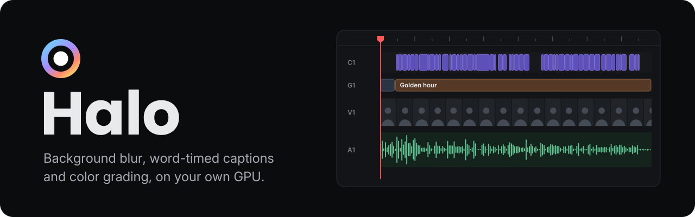
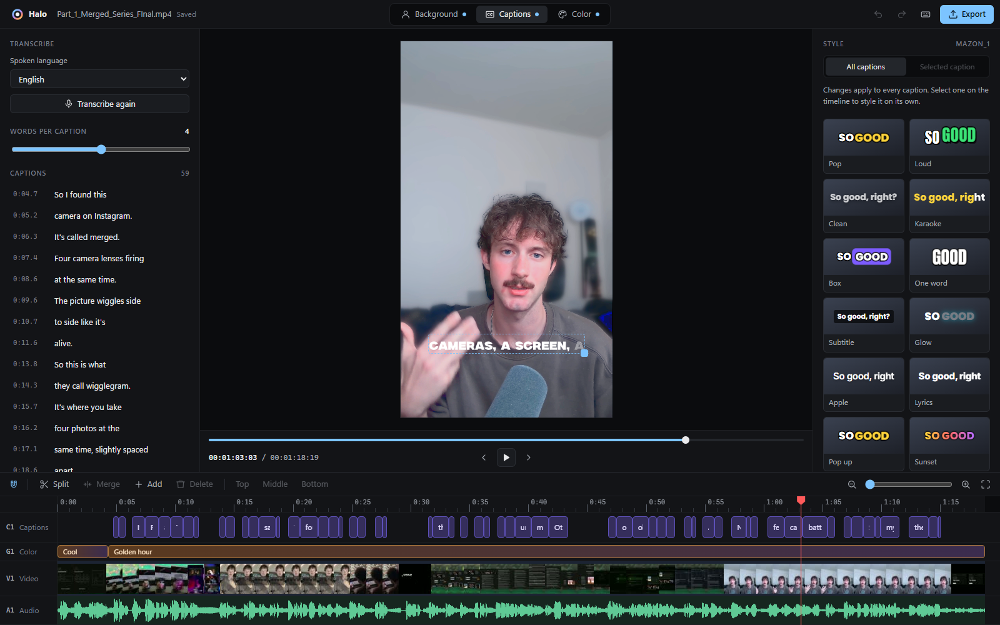
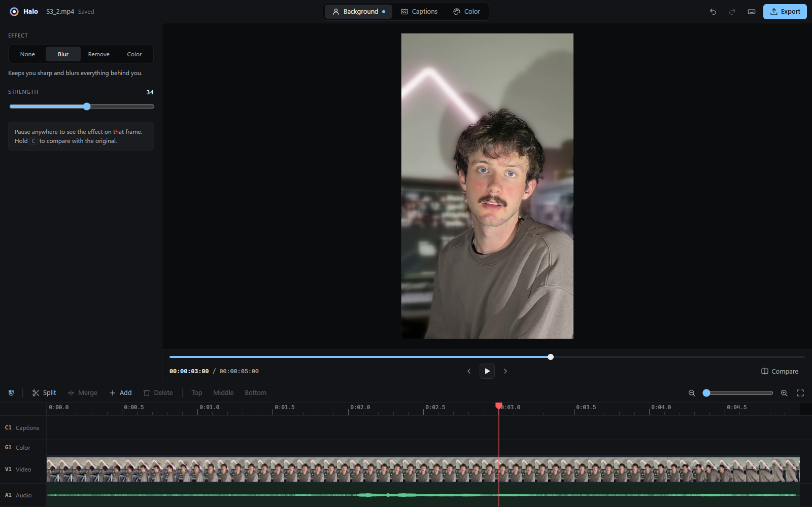
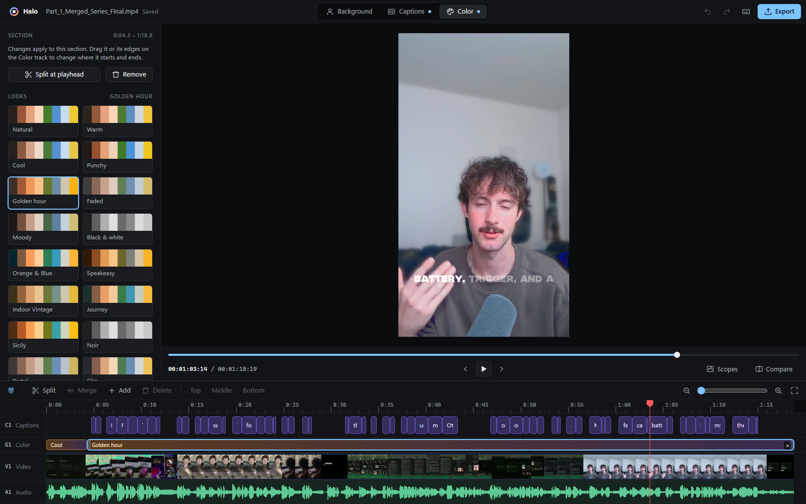

<div align="center">

<picture>
  <source media="(prefers-color-scheme: dark)" srcset="docs/assets/brand/banner-dark.svg">
  <source media="(prefers-color-scheme: light)" srcset="docs/assets/brand/banner-light.svg">
  
</picture>

**Blur or remove the background behind you, caption every word, and color grade the result.<br>A desktop video editor for Windows, macOS and Linux that runs on your own computer. Nothing leaves it.**

[](https://github.com/Mazon3442/Halo/releases/latest)
[](LICENSE)
[](#install)
[](https://tauri.app)

[Features](#features) · [Install](#install) · [Quick start](#quick-start) · [Using Halo](#using-halo) · [How it works](#how-it-works) · [Build from source](#build-from-source) · [Privacy](#privacy)

<br>



</div>

## Features

| Feature | What it does |
| --- | --- |
| **Background blur and removal** | A matting model separates you from the room on every frame. Blur what's behind you (and darken it), replace it with a solid color, or remove it and export with transparency. Shift and harden the matte's edge, and check it on a matte view. |
| **Word-timed captions** | Whisper transcribes the speech on your machine, and every word gets its own timing. Pick how many words show at once and how the spoken word stands out. |
| **20 caption styles** | Pop, Loud, Karaoke, Outline, Box, One word, Glow and more, each one a starting point for font, color, outline, shadow, box and animation. Save your own next to them, and drag any of them onto single captions on the timeline. |
| **Easy Motion and plugins** | Caption animations come from plugins. The built-in Easy Motion gives each caption an in and an out (direction, style, distance, frames), extras (scale, rotation, 3D tilt, blur, tracking, fade), a hold effect (float, slow push, pulse, swing, shake) and motion blur, with 17 presets. Add your own plugins as .js files. |
| **Clean up in one pass** | Remove filler words ("um", "uh", "like") across the whole video, fix a misheard name everywhere with find and replace, shift captions that run early or late, or import an SRT or WebVTT file you already have. |
| **Color grading** | Graded the way a colorist works: log footage (Apple Log, S-Log3, V-Log, LogC3, Canon Log 3, D-Log) converted first, then grading in log with real white balance, pivoted contrast, shadow/midtone/highlight color wheels that keep skin tones clean, custom curves, an HSL mixer and print film emulation (Kodak 2383 and 2393, Fuji 3513, Vision3, bleach bypass, black and white). 16 looks built from those, previewed on your own frame. Whites and Blacks set the ends of the range. Grade the whole video or just a stretch of it, add a .cube LUT or a Lightroom preset (curves included), export any grade as a .cube LUT, balance from a picked grey, copy grades between sections, bypass them, and check the result with a split wipe, false colour, or a waveform, RGB parade, vectorscope or histogram. iPhone HDR (HLG) and HDR10 video export looking the way the preview shows it, and every export is encoded and tagged as Rec.709 so players all show the same colours. |
| **A real timeline** | Stacked caption tracks, plus color, video and audio tracks with thumbnails, a waveform and snapping. Drag captions in time or between tracks, Alt-drag to copy, copy and paste, trim, split and merge, ripple delete, retime single words, lock and hide tracks, and draw color grades straight onto the track. Markers (which copy out as YouTube chapters) and In and Out points work as they do in Premiere and Resolve. |
| **Exports that match the preview** | MP4 (H.264 or H.265, on NVENC when there is one), ProRes or WebM, with captions burned in or saved alongside as SRT. Export the whole video or just In to Out. Transparent backgrounds export as ProRes 4444 or WebM with alpha. Save any frame as a full-size PNG. |
| **Projects that keep themselves** | Every video gets an autosaved project, so reopening it brings your edits back, on the tab and frame you left it at. Everything is undoable. |
| **Updates itself** | Halo checks for a new release when it starts and offers to install it. |

<table>
  <tr>
    <td width="50%"></td>
    <td width="50%"></td>
  </tr>
  <tr>
    <td align="center"><sub>Background blur</sub></td>
    <td align="center"><sub>Color looks, per section of the video</sub></td>
  </tr>
</table>

## Install

Everything is on the [latest release](https://github.com/Mazon3442/Halo/releases/latest). ffmpeg comes
with Halo on every system, so there's nothing else to install.

| System | Download | Runs the background model on |
| --- | --- | --- |
| **Windows** 10 and 11 | `Halo_<version>_x64-setup.exe` | Any GPU with DirectX 12 (DirectML) |
| **macOS** 12 or later, Apple Silicon (M1 and later) | `Halo_<version>_aarch64.dmg` | The GPU and Neural Engine (Core ML) |
| **Ubuntu, Debian, Linux Mint, Pop!_OS** | `Halo_<version>_amd64.deb` | The CPU |
| **Fedora, openSUSE, RHEL** | `Halo-<version>-1.x86_64.rpm` | The CPU |
| **Arch, Manjaro, EndeavourOS** | `PKGBUILD` (or the AppImage) | The CPU |
| **Any other Linux** | `Halo_<version>_amd64.AppImage` | The CPU |

**Windows:** run the installer.

**macOS:** open the .dmg and drag Halo to Applications. Halo isn't notarized by Apple, so the first
time, right-click it and choose **Open** (on macOS 15 and later: try to open it, then press **Open
Anyway** in System Settings › Privacy & Security). Intel Macs aren't supported: ONNX Runtime, which runs
the background model, has no Core ML build for them.

**Ubuntu and Debian:**

```bash
sudo apt install ./Halo_<version>_amd64.deb
```

**Fedora and openSUSE:** `sudo dnf install ./Halo-<version>-1.x86_64.rpm` (or `sudo zypper install`).
Fedora's own codecs leave out H.264 and HEVC, which most videos use. If the preview stays black, add
them with [RPM Fusion's multimedia guide](https://rpmfusion.org/Howto/Multimedia). Exports work either
way, since Halo brings its own ffmpeg.

**Arch:** download the release's `PKGBUILD` into an empty folder and run `makepkg -si` there.

**AppImage:** make it executable and run it. It carries its own GStreamer, so videos play on any distro.

```bash
chmod +x Halo_<version>_amd64.AppImage && ./Halo_<version>_amd64.AppImage
```

On Linux, Halo needs WebKitGTK 4.1 (Ubuntu 22.04, Debian 12, Fedora 36 and later have it) and, for the
preview to play videos, GStreamer's codecs; the packages ask for both. You can open a video from the
command line too: `halo video.mp4`.

**Updates:** the Windows and macOS apps and the AppImage update themselves: when a new release is out,
Halo asks when it starts. The .deb, .rpm and Arch packages update like the rest of your system: install
the new release's package over the old one.

## Quick start

1. Open a video with **Ctrl+O** (**⌘O** on a Mac), or drop it on the window.
2. **Background:** pick **Blur** and pause anywhere to see it on that frame. Hold **C** to compare with the original.
3. **Captions:** press **Generate captions**. The first time, press **Download speech models** before that (about 670 MB, once).
4. **Color:** drag along the Color track to mark where a grade goes, then pick a look.
5. Press **Ctrl+E** to export.

Press **?** in the app for every shortcut. On a Mac, Ctrl in a shortcut is ⌘ and Alt is ⌥; the app shows
them that way.

## Using Halo

Halo reads your video in place and keeps a project per video, autosaved, so reopening a file brings its edits back. Projects, saved looks, LUTs, plugins and the speech models live in Halo's data folder: `%APPDATA%\com.mazon.halo` on Windows, `~/Library/Application Support/com.mazon.halo` on macOS, and `~/.local/share/com.mazon.halo` on Linux. Recent videos are listed on the start screen. Everything is undoable (Ctrl+Z / Ctrl+Shift+Z).

**Background tab:** None, Blur, Remove or Color. Pause anywhere to see the effect on that frame,
rendered with the exact model and blur the export uses; hold C to compare with the original. Blur has
presets (Subtle, Portrait, Strong, Spotlight) and can darken the background too. Under Edges, Shift edge
pulls the matte in to trim a halo of the room around hair and shoulders (or out to keep more), and
Hardness tightens soft, see-through edges; Show matte (Alt+M) shows the matte itself, white over black,
to judge them.

**Captions tab:** the first time, Halo downloads the speech models (Whisper large-v3-turbo, 574 MB, and a 95 MB word aligner) into
`%APPDATA%\com.mazon.halo\models`. Generate captions to get word-timed lines. Edit text in place
(Enter moves to the next line, Shift+Enter splits a caption at the cursor, Backspace at the start joins
it to the one before), delete lines, search them, and pick how many words each caption shows; lines you
edit keep exactly what you typed. Captions play live over the video. Captions on screen too briefly for
their length (over 20 characters a second, Netflix's limit) are underlined, on the timeline too, and one
click selects them all.

**Clean up:** remove filler words in one pass ("um", "uh", "like" and friends). Halo finds them all,
you review the list through the captions, and one undo takes the whole cleanup back out. Find and
replace (Ctrl+H) fixes a name Whisper misheard everywhere at once, with the match count before you
replace. Shift timing moves the selected captions, or all of them, earlier or later when they run off
the speech. Import an SRT or WebVTT file (YouTube, Premiere, anywhere) and it comes in styled like a
transcription.

**Caption style (Captions tab, right panel):** 20 presets, plus any you save from your own edits
("Save current as…" puts the edited style next to the built-ins). Then font (bundled or any installed),
size, case (as spoken, capitals, lowercase or Title Case), spacing, colors, how the spoken word stands
out, entrance animation, outline, shadow and background box. Hide punctuation for the clean short-form
look, and bleep swear words (f***) on screen and in caption files. Click any number beside a slider to
type a value, or drag it sideways. Every colour opens Halo's picker: a saturation and brightness
square with a hue strip, a hex field, an eyedropper that picks from anywhere on screen, common caption
colours, and colours you save (kept for every video; right-click one to remove it). Escape puts the
old colour back. Drag the caption box on the video to place captions, or its corner to resize; safe-zone
guides show roughly where TikTok, Reels and Shorts put their buttons. Switch to "Selected" to give the
captions selected on the timeline a style and animation of their own, or drag a style or animation preset
straight onto captions on the timeline. Select a single caption to color individual words.

**Animation:** pick a preset (Pop, Slide up, Mask up, Whip, Zoom blur, Float and more), or open Easy
Motion's sections to set the in and out yourself: a direction, a style (Slide, Mask, Whip, Glide, Spring,
Bounce), distance and duration in frames, then extras, a hold effect and motion blur. Hover a preset to
see it move, and press Preview to play the caption. On the timeline, each caption shows its in and out
as shaded ramps; drag a selected caption's top corners to lengthen or shorten them. Animations are baked
a frame at a time into the subtitle file, so the export moves exactly as the preview does.

**Plugins:** animations are plugins, and Easy Motion is the built-in one. Drop more plugins (.js files)
in `%APPDATA%\com.mazon.halo\plugins` (the Plugins folder button opens it) and they show up in the
Animation menu next time Halo starts. [docs/plugins.md](docs/plugins.md) explains how to write one.

**Color tab:** first, say what the footage was shot in. Log footage (Apple Log on iPhone, Sony S-Log3,
Panasonic V-Log, ARRI LogC3, Canon Log 3, DJI D-Log) looks flat and grey. Halo converts it from the
camera's log curve and gamut across the whole video before any grading, as a color space transform does
in Resolve. HDR video (HLG, which iPhones record by default, or HDR10) is shown and exported in standard
range with HDR's reference white as white, so leave it on Rec.709 / standard. Grades live on the Color track. Drag along an empty stretch of it to draw a grade of
that length, or double-click it (or press "Add a 5s grade at the playhead") for a five-second one;
drag a grade or its edges to move it, and split it at the playhead. Each grade takes a look, light and
color sliders, a print film emulation, three color wheels (shadows, midtones, highlights) with skin
protection, custom curves (master, red, green and blue, over the frame's histogram), an HSL mixer
(hue, saturation and luminance per color, like Lightroom's), and optionally a LUT: import a .cube file
from Premiere, Resolve, Final Cut or CapCut, or a Lightroom preset (.xmp). Pick neutral balances the
color from something white or grey in the frame. Grade mix fades the whole grade up or down. Save a
look you like to use it again, or Export LUT to save the grade as a .cube for Premiere, Resolve or a
camera monitor (for log footage it includes the conversion, so it goes on the original clip). Copy a grade (Ctrl+C) and paste it onto another section (Ctrl+V), apply
it to every section, or take the grade of the section before; double-click a section to name it.
Ctrl+D bypasses the selected grade and Shift+D all of them, in the preview and the export. W splits the
picture with a wipe you drag, the original on one side and the grade on the other. Scopes
(Ctrl+Shift+S) show a waveform, RGB parade, vectorscope and histogram of the graded frame, and false colour
(Alt+F) paints exposure bands over the picture: crushed and near black, 18% grey, a stop over grey (bright
skin), near clipping and clipped. [ and ] trim the selected grade to the playhead, and E moves its
nearest edge there, rolling the cut with a grade it touches.

**Timeline:** caption, color, video and audio tracks with a ruler and playhead. Caption tracks stack
like video tracks in Premiere or Resolve: C1 holds the transcript, and captions on C2 and up show at the
same time, drawn over it. Use them for a hook title over the subtitles, or for two speakers. Drag
captions to move them, and drag them up or down to change tracks; dropping on the "New track" strip makes
one. Alt-drag copies. Drag edges to trim, split at the playhead (Ctrl+K), merge (Shift+M), add (A, or
double-click a gap; when the playhead is over a caption, the new one stacks on the next track), delete,
nudge a frame at a time (Alt+arrows), box-select across tracks, and retime individual words by zooming
in on a selected caption. Shift+Delete deletes and closes the gap, and Y selects everything from the
playhead on. Cut, copy and paste with Ctrl+X/C/V (pasting at the playhead), Ctrl+D
duplicates onto the track above, and right-click a caption or track for more. Each track can be renamed,
hidden or locked. Snapping (S) catches the playhead, markers and neighbouring captions, and scrubbing
the ruler stops on edit points.

**Keyboard editing** works the way Premiere and Resolve do. Ctrl+K (or Ctrl+B, Ctrl+\\) splits at the
playhead, Ctrl+Shift+K through every track. Q and W (or [ and ]) trim the start or end of the selected
caption, or the one under the playhead, to the playhead; E moves the nearest edge there, rolling the cut
with a caption it touches. , and . nudge a frame (Shift: five) and Alt+, and Alt+. trim the end a frame.
D selects what's under the playhead, Ctrl+Up / Ctrl+Down step through captions one by one, Enter or F2
edits the text, and X marks the caption as In to Out. Ctrl+Alt+V pastes a copied caption's style onto
the selection. Up / Down, Page Up / Page Down or ; and ' jump between edit points. J, K and L shuttle,
J playing backwards, faster with each press; hold K and tap J or L to step a frame.

**Markers and In / Out:** M drops a marker at the playhead (press it again to name it); drag markers
along the ruler, right-click to color, name or delete them, and Shift+Up / Shift+Down jump between them.
"Copy markers as YouTube chapters" puts them on the clipboard as a chapter list for your description. I
and O set In and Out (Alt+X clears them); looped playback (Ctrl+L) and Play In to Out
(Ctrl+Shift+Space) stay between them, and the export can render just that stretch.

**Player:** click the timecode to type a time (00:01:30:00, 90s, or +15 frames from here), set the
volume or mute, show guides (action and title safe, rule of thirds, centre cross), go full screen
(Shift+F), and save the frame as a full-size PNG with its grade and captions (Shift+E).

**Export (Ctrl+E):** pick the file name and folder (the system's Save As dialog), format (H.264 or H.265
MP4, ProRes MOV, WebM), resolution and quality, whether to burn in captions, and whether to save an
.srt alongside. Transparent backgrounds export as ProRes 4444 or WebM with alpha. "Captions only"
exports a styled caption overlay with transparency, or the text as SRT or WebVTT. Exports run in the
background with progress in the top bar, can be cancelled, and are written under a temporary name so
a failed or cancelled export never replaces an existing file. Audio is kept. With In and Out set, the
export renders that stretch alone, captions, grades and audio included.

## How it works

A Rust backend runs [Robust Video Matting](https://github.com/PeterL1n/RobustVideoMatting) through
ONNX Runtime (on the GPU with DirectML on Windows and Core ML on macOS, on the CPU on Linux),
transcribes speech with [whisper.cpp](https://github.com/ggml-org/whisper.cpp), and uses ffmpeg for
decoding, blurring, caption burn-in and encoding (on the GPU with NVENC on NVIDIA cards and
VideoToolbox on Macs). On Windows whisper.cpp runs inside the bundled ffmpeg, on the GPU through
Vulkan; on macOS and Linux Halo runs it itself (Metal on Macs), since ffmpeg builds there rarely
include it. The window is a Tauri 2 webview (WebView2 on Windows, WebKit on macOS, WebKitGTK on
Linux) talking to that backend over a local API, which requires a per-launch token that only Halo's
window receives.

**Captions** are kept as a list of timed words. The page groups them into lines and writes one ASS
subtitle file, which libass renders both in the page (jassub, WebAssembly) and in ffmpeg at export, so
the live preview matches the output. In Remove mode the captions are also rendered over black and
white to recover their alpha, so text stays visible over the transparent background.

**Color grades** follow a colorist's pipeline, baked into a 33×33×33 3D LUT: the input transform (log
curve and camera gamut to light), exposure and white balance as a Bradford chromatic adaptation,
then grading in the ACEScct log space (contrast around mid grey, tone, color wheels weighted by
brightness with skin tones keyed out), print film emulation (a density curve per channel, whose small
differences give film its color crossover), saturation on light, the HSL mixer, a filmic tone map
for log footage, and out-of-range colors pulled in along their own hue rather than clipped per
channel. Any imported LUT comes last. The preview applies it to the video with WebGL, and the export applies the same
LUT with ffmpeg's `lut3d`, so what you see is what you get. HDR video is brought to standard range as it's
decoded, through a 65-point LUT on 16-bit RGB that reproduces how Chromium (and so WebView2) shows HLG
and PQ on an ordinary screen (measured against it: within a code value on greys). WebKit on macOS and
Linux maps HDR its own way, so there an HDR clip's preview can differ a little from its export. Exports are converted to YUV with the
Rec.709 matrix and tagged as Rec.709, where ffmpeg would otherwise use Rec.601 and tag nothing, which
players read as Rec.709 and show shifted.

**Exports** run as three overlapping stages: ffmpeg decoding, GPU inference, and compositing plus
encoding. The matting model runs at up to 1920px on the long side and its matte is scaled back up. The
background blur leaves the subject out: each pixel counts by how surely it's background, so the person
never smears into the blur around them and what they hide is filled in from around it. It's blurred in
linear light, so lights keep their strength, on a grid coarse enough that a strong blur costs no more
than a light one. Edge pixels, where the frame still holds some of the room, take the model's estimate
of the subject's colour instead. Pixel work is spread across all CPU cores.

## Build from source

Needs Rust 1.85 or later and Node (for the Tauri CLI). The matting model is in
`models/rvm_mobilenetv3_fp32.onnx` (from the RVM v1.0.0 release). Settings shared by every system are
in `tauri.conf.json`; `tauri.windows.conf.json`, `tauri.macos.conf.json` and `tauri.linux.conf.json` add
each system's packages.

**Windows:** `ffmpeg/ffmpeg.exe` and `ffmpeg/ffprobe.exe` (the [gyan.dev](https://www.gyan.dev/ffmpeg/builds/)
full build, which has whisper) go in the installer, so nothing has to be on PATH.

```bash
cargo build --release                    # DirectML.dll is copied next to the exe, which the bundle needs
npx @tauri-apps/cli@2 build              # installer in target/release/bundle/nsis
```

**Linux:** install WebKitGTK and the build tools first, then fetch ONNX Runtime, which Halo loads at
runtime on Linux: `packaging/fetch-onnxruntime.sh` puts Microsoft's build (it needs only glibc 2.28) in
`onnxruntime/`, and every package carries it. A development build uses the ffmpeg on your PATH (any
recent one: captions don't need its whisper filter there).

```bash
# Ubuntu / Debian
sudo apt install build-essential libwebkit2gtk-4.1-dev libappindicator3-dev librsvg2-dev libxdo-dev \
  cmake clang ffmpeg gstreamer1.0-plugins-good gstreamer1.0-libav
# Fedora
sudo dnf install webkit2gtk4.1-devel libappindicator-gtk3-devel librsvg2-devel libxdo-devel \
  cmake clang ffmpeg-free gstreamer1-plugins-good
# Arch
sudo pacman -S --needed base-devel webkit2gtk-4.1 libappindicator-gtk3 librsvg xdotool cmake clang ffmpeg \
  gst-plugins-good gst-libav

packaging/fetch-onnxruntime.sh
cargo run                                # or: npx @tauri-apps/cli@2 build  (deb, rpm and AppImage)
```

Whisper runs on the CPU on Linux. With the Vulkan headers and `glslc` installed,
`cargo build --release --features vulkan` runs it on the GPU instead.

**macOS:** install Xcode's command line tools (`xcode-select --install`) and ffmpeg
(`brew install ffmpeg`), then `cargo run`, or `npx @tauri-apps/cli@2 build` for the .app and .dmg.

To bundle ffmpeg into a Linux or macOS package as the releases do, put `ffmpeg` and `ffprobe` in
`ffmpeg/` and add them as resources:
`npx @tauri-apps/cli@2 build --config '{"bundle":{"resources":{"ffmpeg/ffmpeg":"ffmpeg","ffmpeg/ffprobe":"ffprobe"}}}'`.
`packaging/check-ffmpeg.sh` checks a build has everything Halo uses.

If the background model misbehaves on a GPU, `HALO_CPU=1` runs it on the CPU instead, to rule the
graphics driver out.

`web/vendor/jassub` is [jassub](https://github.com/ThaUnknown/jassub) 2.5.23, bundled with esbuild into
standalone files. `web/fonts` holds the caption fonts, each under its own open license (the license
files sit next to them).

### Release

Push an annotated version tag and GitHub Actions (`.github/workflows/release.yml`) builds Halo on
Windows, macOS and Linux, signs the builds for in-app updates and publishes one release with all of
them, an Arch `PKGBUILD` filled in for it, and the update manifest; the tag's message becomes the
release notes. The version comes from the tag, so there's nothing to bump. Every pull request is built
and tested on all three by `.github/workflows/ci.yml`.

```bash
git tag -a v0.3.0 -F notes.md
git push origin v0.3.0
```

Installed copies check the latest release's `latest.json` on launch and offer to update. Updates are
signed with the `TAURI_SIGNING_PRIVATE_KEY` repository secret, the private half of the `pubkey` in
`tauri.conf.json` (kept locally in `~/.tauri/halo-updater.key`). Tags with a hyphen (`v1.0.0-beta.1`)
become pre-releases, which installed copies don't update to. macOS builds are signed ad hoc; with a
Developer ID in the `APPLE_CERTIFICATE`, `APPLE_CERTIFICATE_PASSWORD`, `APPLE_SIGNING_IDENTITY`,
`APPLE_ID`, `APPLE_PASSWORD` and `APPLE_TEAM_ID` secrets they're signed and notarized instead, and open
without the right-click.

## Privacy

Halo has no accounts and no telemetry. Your videos, captions and projects stay on your computer, and
all processing runs on it. Halo connects to the internet only to check GitHub for a new version when
it starts, and to download the speech models from Hugging Face the first time you generate captions.
Those services see the usual request details, such as your IP address.

## License

Halo's code is released under the [MIT License](LICENSE). The bundled ffmpeg, fonts and models keep
their own licenses.

<div align="center">
<br>

</div>
